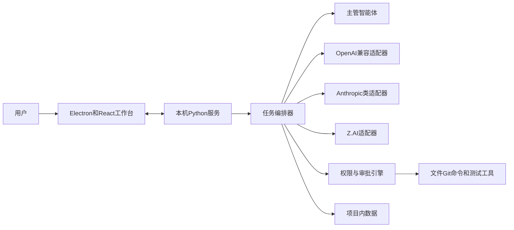
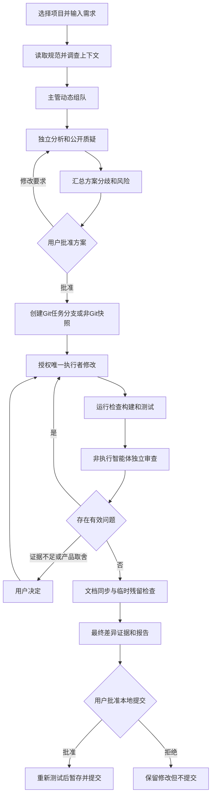

# 多智能体协作桥梁软件方案

**日期：** 2026-08-30  
**状态：** 已经用户确认，当前实施与验收依据  
**平台：** Windows  
**对象：** 单用户、本地使用

## 1. 文档目的与职责边界

本方案定义一款个人多智能体协作桌面软件。软件将 ChatGPT、Claude、Z.AI 通过 API 接入同一工作台，由可配置的主管智能体动态组织角色，使多个模型公开讨论、相互质疑、交叉验证，并在用户批准后完成受控的软件开发任务。

本文件规定产品目标、范围、模块边界、关键流程、安全规则、扩展方向和验收标准。用户已授权按本方案开始实施；具体任务顺序、文件路径和技术选择由实施计划管理。

- 用户负责目标、需求范围、重大取舍和高风险操作的最终决定。
- 实施方负责选择具体依赖、代码结构和内部算法，完成开发、测试、打包和文档。
- 方案制定方不替实施方决定非必要的内部实现细节；开发完成后依据本方案和真实证据负责验收。
- 范围扩大、关键规则变更或无法通过技术证据裁决的产品取舍，必须交由用户决定。

## 2. 产品定位与已确认决策

产品形态是通用多智能体工作台，能力优先级为：软件开发协作、调研与内容、通用自动化。第一版只实现软件开发闭环，后两类仅预留扩展边界。

第一版核心闭环：

> 选择本地项目 → 输入需求 → 主管动态组队 → 多模型公开讨论 → 用户批准方案 → 单一执行者修改代码 → 运行检查和测试 → 其他智能体独立审查 → 展示证据和报告 → 用户决定是否创建本地 Git 提交。

| 决策项 | 已确认规则 |
|---|---|
| 组织方式 | 主管智能体动态组队 |
| 模型来源 | ChatGPT 中转站、Claude 中转站、Z.AI API |
| 连接方式 | 图形化填写 Base URL、API Key、模型名并测试连接 |
| 工作入口 | 统一桌面工作台，不直接操控原桌面客户端 |
| 自主权 | 方案和高风险节点由用户确认 |
| 平台 | Windows 安装包 |
| 代码修改 | 任一时刻只有一个执行智能体具有写权限 |
| 交流 | 全量公开群聊；允许 `@智能体`、插话、暂停、继续和重新分工 |
| 项目 | Git 项目和普通文件夹 |
| 隐私 | 智能筛选上下文，默认阻止敏感信息发送 |
| 裁决 | 实际证据优先；关键产品取舍交由用户 |
| 执行环境 | 第一版仅 Windows PowerShell/CMD |
| 数据 | 项目内 `.multi-agent` 长期保存，默认加入 `.gitignore` |
| Git | 本地分支、暂存和提交；不推送 |
| 模型策略 | 主管可配置并支持备用主管；默认三个模型参加，可减少 |
| 工作台 | 文件树、任务、群聊、审批、Diff、终端、测试；不做完整 IDE |
| 联网 | 可读取官方文档和公开源码；下载、安装、执行外部内容需审批 |
| 技术栈 | Python > JS/TS > CSS/HTML > C++ > Java |
| 并发 | 第一版一次运行一个任务，预留任务队列和多项目并发 |
| 语言 | 中文为主，必要时保留英文原文 |
| 角色 | 用户可以创建和编辑角色 |
| 用户体系 | 单用户本地模式，不做登录、团队和远程服务 |

## 3. 开源参考与复用原则

方案参考 OpenHands 的本地编码工作区与执行边界、LangGraph 的有状态流程和人工介入、CrewAI 的角色任务抽象，以及 AutoGen/AutoGen Studio 的多智能体会话思路，但不直接套用任何完整产品。AutoGen 官方仓库目前已将新用户引导至 Microsoft Agent Framework，因此不得把 AutoGen 视为无需复核即可长期采用的核心依赖。

| 参考项目 | 主要借鉴 | 截至 2026-08-30 的官方仓库信息 | 不直接照搬的原因 |
|---|---|---|---|
| [OpenHands](https://github.com/All-Hands-AI/OpenHands) | 编码工作区、受控执行、会话可追踪 | SDK 与 CLI 标明 MIT，其他部分包含 source-available 授权，复用前必须逐组件核查 | 产品范围较大，直接引入会增加个人桌面工具的复杂度 |
| [LangGraph](https://github.com/langchain-ai/langgraph) | 有状态流程、暂停恢复、人工审批节点 | 官方仓库标明 MIT，仍需核查拟用版本及其依赖 | 具体编排框架不应决定产品协议和存储边界 |
| [CrewAI](https://github.com/crewAIInc/crewAI) | 角色、任务、协作组织方式 | 官方仓库标明 MIT，仍需核查拟用版本及其依赖 | 角色抽象可借鉴，但权限必须由本地程序强制控制 |
| [AutoGen / AutoGen Studio](https://github.com/microsoft/autogen) | 群聊、多智能体消息和工作台思路 | 官方仓库标明 MIT，但处于维护状态并引导新用户转向 Microsoft Agent Framework | 官方方向已经变化，仅作为设计资料，不预设为实施依赖 |

调研来源以各项目官方 GitHub 仓库、正式文档、发布记录和安全公告为准，不以二次转载作为许可证或维护状态依据。

实施前必须针对拟采用的具体版本重新核查许可证、维护状态、已知安全问题、Windows 适配和长期成本。优先复用边界清晰、许可证兼容、维护活跃且可替换的基础库；不为了复用而引入与第一版无关的大型平台，也不把核心规则锁死在某一家模型或某一个框架中。

## 4. 推荐总体架构

采用 Electron + React/TypeScript 桌面工作台、Python 编排内核和本地项目存储。

桌面应用自动启动和关闭 Python 服务。服务只监听 `127.0.0.1`，使用临时会话凭证验证通信，不向局域网或公网开放。具体通信库、端口和打包方式由实施方决定，但必须保证异常退出后不遗留失控后台进程。

核心原则：

1. 主管动态组队，默认多模型交叉验证。
2. 任一时刻只有一个获授权写入者。
3. 权限与审批由程序强制执行，不依赖模型自律。
4. 测试、编译、真实运行、当前源码和正式文档高于模型意见。
5. 产品取舍和证据不足的高风险问题由用户最终决定。
6. 所有发言、工具调用、错误、审批和证据可见、可追踪。
7. 默认最小权限、限制项目目录、保护敏感信息。
8. 状态持久化，支持中断、故障和冲突恢复。
9. 新模型、新工具和新执行器不能绕过既有审批和记录体系。

### 4.1 架构关系

## 5. 标准开发任务流程

较大功能开始前优先检索 GitHub、官方文档和同类实现并比较许可证、维护状态、安全和适配成本；简单 Bug、明确小改动和离线任务可以省略强制外部调研。外部依据应标注来源，无法验证时必须明确说明。

重要任务先让参与模型独立分析，再公开质疑，避免盲目附和。用户批准方案前不得修改业务代码；执行阶段只有一个写入者，且至少由一个未直接修改代码的智能体独立审查。

## 6. 模块职责

### 6.1 桌面工作台

负责打开项目、文件树、任务状态、全量群聊、用户介入、审批、Diff、终端、测试和最终报告，以及模型、角色和项目设置。第一版不承担代码补全、调试器或插件市场职责。

### 6.2 任务编排器

任务编排器是确定性的流程控制模块，而不是某个模型。它负责生命周期、阶段转换、调度、暂停恢复、故障恢复、审批门禁、循环检测和可恢复状态保存。

### 6.3 主管智能体

主管负责理解需求、选择角色和模型、拆分任务、整理分歧和风险、形成方案、提议唯一执行者，并根据验证证据建议返工或结束。主管只能提出操作请求，不能绕过编排器和审批引擎。

### 6.4 角色系统

用户可以定义角色名称、职责、系统提示词、首选与备用模型、擅长领域、上下文范围、可申请工具和权限、是否可以申请成为执行者及输出要求。系统提供主管、需求、架构、开发、测试、代码审查和安全审查等基础模板。角色与模型相互独立。

### 6.5 模型接入层

第一版覆盖 OpenAI 兼容协议和自定义 Base URL、Anthropic Messages 类协议、Z.AI API，以及流式输出、取消、超时、有限重试和连接诊断。接口支持时探测模型列表，否则允许手动填写模型名。第一版不读取其他客户端的账号、Cookie 或凭据。

### 6.6 上下文管理器

按任务选择必要文件和项目规范，记录各智能体实际收到的上下文和文件版本；避免无差别发送整个项目；为长对话生成可追踪摘要但保留本地原始记录；默认阻止敏感、大型和二进制内容。

### 6.7 权限与审批引擎

普通分析智能体默认只读。删除、批量移动、敏感覆盖、安装依赖、运行高风险命令、访问项目外路径和 Git 提交必须审批。联网默认只允许读取公开文档和源码；下载或执行外部内容需审批。用户可以随时撤销写权限或停止任务。审批记录请求者、理由、目标、命令、风险、决定和时间。

### 6.8 项目工具层

第一版提供受控的文件读取、搜索、修改和差异计算，Git 状态、分支、暂存和本地提交，PowerShell/CMD，项目与依赖识别，测试、构建、静态检查、格式检查，以及只读访问官方文档和公开源码。每次调用返回状态、输出、错误、耗时和影响范围，模型不得绕过工具层直接操作系统。

### 6.9 项目数据与扩展

项目数据模块保存状态、消息、审批、命令、证据、差异、快照和报告。系统预留新模型、新角色、新工具、新执行环境、新任务类型、新证据类型、多任务队列和多项目并发的接入边界，但第一版不制作无实际功能的空白页面。

## 7. 工作台与人机交互

主界面采用三块信息区：

- 左侧显示项目路径、Git 或快照状态、任务列表和阶段。
- 中间显示全量智能体消息、工具调用、错误、证据和用户输入。
- 右侧显示主管、参与者、子任务、待审批事项、Diff、测试、风险和报告。

用户新建任务时只需选择项目、输入需求、选择或沿用主管、确认参与模式并开始。系统识别项目、测试命令候选、相关文件、角色组合和风险。无法可靠识别关键命令时必须提问，不能执行猜测出的高风险操作。

有效工作消息应能追踪模型与角色、任务与阶段、消息类型、结论或请求、使用的上下文、关联文件或命令、测试或外部来源、风险和下一步。用户的新要求必须进入记录并标明影响范围。

审批卡片至少说明提出者、原因、目标文件或目录、完整命令、是否联网、是否下载或安装、是否可回滚和风险。用户可以批准一次、批准本阶段同类操作、拒绝、修改后重试或终止任务。没有操作不得视为默认批准。

任务状态必须区分：已修改但未验证、已修改并通过指定验证、已完成但未提交、已完成并创建本地提交、因环境限制尚未验证。不得只显示已完成而隐藏差异和未解决问题。

## 8. 协作协议与证据规则

证据优先级为：

1. 可重复的测试、编译、静态检查和真实运行结果。
2. 当前源码、配置、依赖、接口协议和正式项目文档。
3. 官方文档、项目源码、维护者说明和可信安全公告。
4. 能说明前提和验证方法的技术推理。
5. 无直接证据的模型意见。

主管必须展示分歧双方、证据、已执行验证、建议及理由。测试可以裁决的代码问题优先依赖测试；无法客观验证的架构和产品取舍由主管给出建议，最终由用户决定。

质量优先不等于无限调用。系统应检测高度重复、连续无新证据和结论无变化；多轮无进展时汇总阻碍并请求用户决定；提供手动停止按钮；显示调用量、耗时和阶段；设置技术性硬上限防止程序故障产生无限请求。具体数值由实施方提出并由用户确认。

## 9. 异常与冲突处理

### 9.1 模型异常

保留已收到的流式内容并显示真实错误，不伪造失败模型的结论；进行有限、安全的重试；允许角色切换备用模型。单个参与模型失败时其余模型可继续，主管失败时由备用主管基于结构化状态接管。若任务明确要求三模型验证，缺少其中一个时必须标记交叉验证未完整完成。

### 9.2 命令与文件异常

记录命令、工作目录、时间、退出码、标准输出、错误输出、超时或终止状态、文件变化和恢复能力。失败后不得自动重复可能造成破坏的命令；需要改变环境或依赖时重新审批。

发现用户或其他编辑器修改同一文件时，停止继续写入，展示磁盘版本、执行者基准版本和待应用修改之间的差异，不自动覆盖，由用户决定重新读取、合并、放弃或恢复。

### 9.3 异常退出

重启后检查未完成任务、项目路径、记录完整性和文件变化，显示最近稳定阶段。不得自动重放命令、恢复模型请求或批准操作。

## 10. 安全、隐私与存储

第一版不提供注册、团队权限、局域网服务、公网服务、云同步、远程控制或公共插件市场。

API Key 使用 Windows 安全凭据机制保存。项目数据、SQLite、日志和导出内容不得包含明文密钥；界面显示脱敏信息；连接错误不得暴露完整密钥；删除连接时删除对应凭据；群聊和命令输出发现疑似凭据时遮盖。

任务只能访问用户选择的项目目录。默认禁止跟随链接访问项目外位置、修改系统目录、读取浏览器或其他客户端凭据。项目外访问必须显示完整路径、目的和风险并单独审批。

发送上下文前默认检查并阻止 `.env` 及其变体、私钥、证书、密钥库、API Key、Token、密码、云凭据、数据库连接信息、会话文件、Git 凭据、SSH 配置、额外敏感路径、超大文件、二进制文件和数据集。

确有需要时，审批必须说明目标文件、接收模型和 Base URL，并允许拒绝、只发脱敏版本、仅本次允许或建立项目级指定文件规则。

配置界面必须提示：代码会发送到所配置的中转站；连接成功不代表中转站可信；软件无法保证第三方的数据政策；私人或商业敏感代码应谨慎发送。方案不替用户判断具体中转站是否可信。

项目记录保存在 `<项目目录>/.multi-agent/`，逻辑上包含项目设置、任务、消息、证据、审批、日志、Diff、非 Git 快照和报告。具体文件组织由实施方决定。

首次启用 Git 项目时建议把 `.multi-agent/` 加入 `.gitignore`；修改 `.gitignore` 前展示差异并取得一次批准。长期保存需求、消息、模型与角色记录、上下文发送记录、工具调用、审批、差异、测试、异常和报告；不得保存明文 API Key、未经允许的项目外内容和无诊断价值的临时缓存。第一版至少支持明确删除单个任务记录，并在删除前说明影响范围。

Git 项目修改前确认当前分支、提交和工作区状态，不覆盖或清理用户已有未提交修改，并区分原有修改与本任务修改。只执行本地流程，不自动推送；暂存和提交需审批；不默认使用会丢失内容的强制重置。

非 Git 项目执行前建立基线快照，记录待修改原文件、新建文件、路径、大小、时间和校验信息。支持恢复单文件、某次修改前状态或整个任务基线，并允许恢复前预览差异。快照不能替代 Git 或正式备份。

## 11. 文档同步与临时残留检查

开发任务收尾时，系统必须提醒并记录是否需要同步 README、开发规范、接口文档、数据结构说明、用户操作说明和当前状态文档。功能、接口、数据、交互或模块职责发生变化时，对应当前执行文档必须更新；纯内部实现调整且不影响外部使用时，可以记录无需更新及理由。

当前执行文档应直接描述真实规则，历史设计和迁移说明不能替代当前入口文档。发现旧文档会误导后续智能体或人工开发者时，必须更新或归档，并清晰区分当前文档与历史资料。

准备报告完成、运行最终验证或申请 Git 提交前，必须检查本任务产生的调试打印、一次性脚本、临时文件、临时模拟数据、写死测试数据、临时开关、无引用验证代码和无诊断价值的缓存。明确属于临时验证的内容应清理；正式测试、测试夹具、正式文档和有意保留的诊断日志不得误删。无法判断的项目必须列出路径、用途、风险和建议，由用户决定。

## 12. 第一版必须交付的能力

第一版只有同时满足下列能力，才构成完整的软件开发闭环：

1. Windows 桌面安装、启动、关闭和卸载流程；本地服务只监听回环地址，退出后不遗留失控进程。
2. 图形化配置 ChatGPT 中转站、Claude 中转站和 Z.AI API，支持连接诊断、模型名设置、启停和脱敏展示。
3. 可配置主管和备用主管，默认组织三个模型参与，并允许用户或主管减少参与者。
4. 用户可创建、编辑、启用和停用角色；角色与模型分离，同一模型可承担不同角色。
5. 打开 Git 项目或普通文件夹，识别项目状态、规范、常见技术栈和可验证入口。
6. 完整的公开协作消息流，支持 `@智能体`、用户插话、暂停、继续、换主管、换执行者和重新分工。
7. 用户批准方案后才允许进入写入阶段；任一时刻只有一个执行者获得写权限。
8. 受控文件、Git、PowerShell/CMD、测试、构建、静态检查和只读联网能力，所有调用可追踪。
9. 对危险操作、项目外访问、依赖安装、外部内容下载与执行、敏感信息发送和 Git 提交实施强制审批。
10. 展示文件差异、命令结果、测试证据、审查意见、未解决风险和任务最终状态。
11. Git 项目支持本地任务分支、暂存和提交但不推送；普通文件夹支持基线快照和差异恢复。
12. 项目内长期保存可恢复任务状态，重启后能够识别未完成任务，但不自动重放操作。
13. 检查文档同步和临时残留，生成可供人工复核的最终报告。
14. 提供手动停止、循环检测、有限重试、调用与耗时可见性以及防止失控请求的技术硬上限。

## 13. 第一版明确不做

第一版不包含以下能力：

- 不直接控制 ChatGPT、Claude 或 Zcode 桌面客户端，不读取其登录态、Cookie、历史会话或本地凭据。
- 不提供完整 IDE、代码补全、可视化调试器、终端模拟器替代品或编辑器插件市场。
- 不提供团队账号、多人权限、局域网访问、公网服务、云端控制台、云同步或远程执行。
- 不自动推送 Git 远端、不自动创建 Pull Request、不自动发布、不自动部署生产环境。
- 不默认获得管理员权限，不修改系统级环境，不访问所选项目之外的数据。
- 不制作调研工作台、内容生产流水线或通用自动化界面，仅保留可实现这些能力的协议边界。
- 不支持同时运行多个任务或多个项目，不承诺跨设备迁移和第三方插件生态。
- 不以模型自行声明成功作为完成依据，不以自动批准替代用户的关键决定。

## 14. 后续扩展边界

扩展必须复用统一的任务状态、消息、证据、审批、权限、工具调用、恢复和报告协议，不能绕过第一版形成另一套不可审计流程。

### 14.1 调研与内容协作

可增加来源检索、资料阅读、引用记录、事实核验、提纲、写作、审校和导出等任务类型。来源必须能追踪到具体页面或文件，事实与模型推断要明确区分，敏感信息和下载审批继续适用。该扩展不应依赖代码写入者概念，但仍需定义唯一的产物编辑者，避免多个智能体同时覆盖同一文档。

### 14.2 通用自动化

可增加本地应用连接器、浏览器操作、文件批处理和可复用流程。每个连接器必须声明输入、输出、权限、风险、可回滚能力和审计字段。发送消息、购买、发布、删除云端数据等会影响外部世界的操作必须单独授权，不能把一次批准无限继承到后续任务。

### 14.3 多任务与多项目

预留任务队列、资源配额、项目级隔离和并发调度接口。未来并发时，每个任务仍须拥有独立状态、审批上下文、执行者锁、日志和恢复点；不同项目之间默认不得共享文件上下文或敏感规则。

### 14.4 新模型、工具与执行环境

新增模型通过适配层接入，新增工具通过统一权限和审计协议注册。未来可增加 WSL、容器或远程沙箱，但其文件边界、网络边界和审批规则必须比本机执行更明确。扩展不得要求改写现有任务记录才能读取历史数据，必要的数据迁移应可验证、可回滚。

## 15. 建议性开发阶段

以下仅用于控制交付风险，不是具体实施计划，也不预先决定依赖、目录、算法、工期或人员安排：

1. 验证模型连接、流式消息、取消、错误分类和凭据安全的最小闭环。
2. 建立任务状态、公开消息、主管调度、暂停恢复和人工审批闭环。
3. 接入只读项目理解、上下文筛选和敏感信息拦截。
4. 接入唯一写入者、文件差异、Git 流程和非 Git 快照恢复。
5. 接入测试、构建、静态检查、独立审查、文档同步和最终报告。
6. 完成异常退出恢复、冲突处理、循环熔断、安装包和系统级验收。

每一阶段应形成可独立验证的纵向闭环，不能只完成界面而没有真实后端，也不能只完成模型调用而缺少权限、证据和恢复能力。实施方应在阶段开始前提出具体技术选择和验证方式，由用户决定需要批准的产品取舍。

## 16. 测试与验证要求

实施方负责根据最终技术选型建立测试体系，但不得以单一类型测试替代完整验证。至少覆盖：

### 16.1 自动化测试

- 任务状态转换、审批门禁、唯一写入者锁、暂停恢复、取消和循环熔断。
- 模型适配器的流式响应、超时、取消、重试、错误归类、主管切换和部分失败。
- 上下文选择、文件版本记录、敏感信息识别、脱敏和阻止发送。
- 文件边界、链接逃逸、项目外路径、危险命令和未经批准操作的拒绝。
- Git 原有修改保护、任务修改识别、分支、暂存、提交门禁和禁止自动推送。
- 非 Git 快照创建、差异预览、单文件恢复和任务基线恢复。
- 持久化、异常中断后的状态读取、记录完整性和禁止自动重放。
- 角色配置、项目设置、任务删除、数据迁移和旧记录兼容。

### 16.2 集成测试

- 桌面界面与 Python 服务之间的启动、鉴权、通信、断线重连和退出清理。
- 至少覆盖 OpenAI 兼容、Anthropic Messages 类和 Z.AI 三类真实或协议级测试连接。
- 从选择项目到生成最终报告的完整任务流程，包括审批、写入、验证、审查和恢复。
- PowerShell/CMD、Git、文件系统、测试工具和联网读取在 Windows 环境中的协同。
- 安装、升级、卸载以及项目数据和 Windows 凭据的保留或清理行为。

### 16.3 人工与系统级测试

- 使用真实桌面安装包、真实项目、真实模型接口和真实 Windows 凭据机制完成验收。
- 对群聊可读性、审批信息完整性、Diff 可理解性、错误提示、暂停和恢复进行人工检查。
- 模拟断网、限流、无效密钥、模型长时间无响应、应用强制退出、磁盘空间不足和文件被外部修改。
- 使用自动化无法充分证明的真实 GUI、进程回收、系统凭据、安装器和恢复体验，必须留存屏幕或日志证据。

测试替身可用于开发阶段，但不能替代真实接口和真实文件修改闭环的最终验收。受环境限制无法执行的项目必须标记为未验证，说明原因、风险和补验条件，不能折算为通过。

## 17. 验收环境与准备条件

最终验收使用接近用户实际使用方式的 Windows 环境，具体 Windows 版本、硬件基线、安装包格式和模型版本由实施方在验收前提出，并经用户确认后固化为验收记录。至少准备：

- 一个包含既有未提交修改、可运行检查和测试的 Git 示例项目。
- 一个不使用 Git、包含多种文本文件的普通文件夹项目。
- 三类已授权测试连接；若使用中转站，记录 Base URL 的脱敏标识和协议类型。
- 可控制的失败条件，包括无效凭据、超时、限流、断网和部分模型不可用。
- 包含模拟 `.env`、测试私钥、假 Token、大文件、二进制文件和链接逃逸的安全测试资料，严禁使用真实生产密钥。
- 可验证外部编辑冲突、异常退出、重新启动、文件恢复和 Git 提交门禁的测试步骤。

验收前实施方必须提交版本标识、构建来源、依赖清单、许可证清单、已知限制、测试命令和验收数据清理说明。验收过程中不得临时修改生产构建来绕过失败；如需修复，必须生成新的可识别构建并重跑受影响项目。

## 18. 核心验收场景

每个场景必须保存操作步骤、输入、模型和角色、审批记录、命令及退出码、文件差异、测试结果、异常、最终状态和必要的界面证据。以下场景全部属于第一版核心验收。

### 18.1 三模型软件开发闭环

在可测试的 Git 项目中输入一项边界明确的小功能需求，三个模型分别承担主管、执行或审查角色并公开协作。用户批准方案后，仅一个执行者修改文件；完成项目既有检查和测试；至少一个未直接修改代码的智能体独立审查；显示最终差异、证据、风险和提交选择。

通过条件：未批准前无业务文件写入；不存在并发写入者；三模型的有效贡献可追踪；测试结果与真实命令一致；原有未提交修改未被覆盖或混入本任务提交；软件未自动推送；任务状态准确。

### 18.2 用户实时介入

任务讨论和执行期间分别测试用户插话、`@智能体`、暂停、继续、重新分工、换主管和撤销写权限。

通过条件：用户消息立即进入记录；暂停后不再启动新的模型调用或工具操作；正在执行的可取消操作按规则停止并记录结果；恢复时从可解释状态继续；换主管和换执行者不丢失上下文且不会出现两个写入者。

### 18.3 模型接口失败

分别模拟参与模型超时、限流、无效凭据、流式中断以及主管失联。

通过条件：显示真实错误和已收到内容；重试有限且可停止；不会伪造失败模型意见；其他参与者能按规则继续；主管失败时备用主管读取结构化状态接管；缺少必要模型时明确标记交叉验证不完整。

### 18.4 危险操作拦截

让执行者申请删除文件、批量移动、访问项目外路径、安装依赖、下载并执行外部内容、运行高风险命令和创建 Git 提交。

通过条件：所有操作在执行前出现完整审批信息；拒绝后无副作用；仅本次批准不会扩展到其他目标；审批被撤销或应用重启后不能继续沿用；程序层门禁能阻止模型绕过审批。

### 18.5 敏感信息保护

在安全测试项目中放置假 `.env`、假私钥、假 Token、证书、大文件和二进制文件，并触发模型请求和日志输出。

通过条件：默认阻止或脱敏；界面说明目标文件、接收模型和 Base URL；未经专门批准不发送原文；API Key 不出现在项目数据、SQLite、日志、错误或导出中；连接配置只显示脱敏值；删除连接后对应凭据按设计清理。

### 18.6 外部文件冲突

执行者读取文件并准备修改后，使用外部编辑器改变同一文件，再尝试应用修改。

通过条件：系统识别基准版本已变化并停止自动覆盖；展示磁盘版本、基准版本和待应用修改差异；用户可以选择重新读取、合并、放弃或恢复；未经决定不写入冲突文件。

### 18.7 非 Git 项目恢复

在普通文件夹中执行包含修改、新建和删除申请的任务，分别恢复单文件、一次修改前状态和整个任务基线。

通过条件：执行前存在完整基线；恢复前能预览影响；恢复结果与记录的校验信息一致；未经批准的删除不会发生；任务记录能区分原文件、新文件和外部变化；恢复不会影响项目外内容。

### 18.8 异常退出恢复

在讨论、等待审批、文件已修改但未验证以及测试执行中等不同阶段强制结束桌面应用，再重新启动。

通过条件：应用识别未完成任务和最近稳定阶段；消息、审批、差异和命令记录保持一致；不会自动重放模型请求、命令或批准；能说明磁盘实际状态和下一步选择；本地 Python 服务和子进程没有失控残留。

## 19. 性能、稳定性与资源规则

本方案不替实施方预设未经测量的固定秒数或硬件消耗。实施方应在验收前基于用户设备、典型项目规模和模型接口特性提出可测量指标，经用户确认后纳入验收基线。指标至少包括：

- 应用冷启动和项目打开时间。
- 本地界面操作、暂停和审批响应时间。
- 长消息、持续流式输出和大任务记录下的界面可用性。
- 本地服务空闲资源、任务运行资源和长期运行后的资源回收。
- 模型并发、超时、取消、重试和熔断行为。
- 大量文件项目的扫描上限、排除规则和渐进处理方式。
- 异常退出后的状态恢复时间和记录完整率。
- 安装包体积、升级成功率和卸载残留范围。

无论最终数值如何，以下属于不可接受问题：界面长期无响应且无法停止；失控重复调用；绕过审批；同时存在多个写入者；退出后持续运行无主进程；任务状态与磁盘事实不一致；因性能降级而静默丢弃消息、证据或审批记录。

模型响应速度和中转站稳定性属于外部变量，报告应将外部等待与本地处理时间分开，不得把第三方延迟伪装成本地软件性能，也不得以第三方故障掩盖本地取消、错误展示或恢复缺陷。

## 20. 实施交付文档要求

开发完成时，实施方除安装包和源码外，至少交付并保持一致：

1. 面向用户的安装、首次配置、连接测试、项目打开、任务运行、审批、停止、恢复和数据删除说明。
2. 面向开发者的架构、模块职责、本地通信边界、任务状态、消息协议、模型适配器、工具协议和存储结构说明。
3. 权限与安全说明，包括凭据存储、敏感信息规则、项目边界、联网、危险命令和威胁假设。
4. Git 与非 Git 工作流、快照恢复、外部冲突和异常退出处理说明。
5. 测试策略、自动化测试入口、验收环境、执行结果、覆盖范围和未验证项。
6. 第三方依赖、版本、许可证、来源、用途、维护状态评估和已知安全风险清单。
7. 构建、打包、升级、卸载、故障诊断和日志位置说明。
8. 当前已知限制、未完成能力和后续扩展接口说明。

当前执行入口和模块 README 必须反映实际软件行为。历史设计、历史计划和迁移记录可以保留背景，但不得与当前操作说明混在一起或继续作为默认执行依据。

## 21. 最终验收结论规则

验收由本方案制定方依据本文件、用户批准的补充决定和实际证据执行。模型意见可以帮助定位问题，但不能自行宣布通过。

验收结论分为：

- **通过：** 第一版必须能力和八个核心场景全部通过；无未解决的安全、数据损坏、权限绕过、恢复或多写入者问题；交付文档与实际行为一致；其他缺陷不影响已确认范围和正常使用。
- **限条件通过：** 核心安全与数据完整性满足要求，存在范围清楚、具有可接受替代方式的非关键问题；必须列出问题、影响、触发条件、临时措施、修复责任和复验条件，并由用户明确接受。
- **不通过：** 任一核心场景失败；关键能力缺失；真实运行无法完成开发闭环；存在未经审批操作、敏感信息泄露、项目外越界、数据损坏、不可恢复修改、并发写入、虚假证据或文档严重失真。

验收报告必须逐项给出通过、失败或未验证，附相应证据。未验证不能视为通过；修复后只重跑直接失败项目还不够时，应同时重跑受影响的回归范围。最终是否接受限条件通过以及何时投入日常使用，由用户决定。

## 22. 方案生效与实施边界

本方案已经用户确认，自 2026-08-30 起作为后续实施和验收依据。

实施可直接进入开源方案调研、依赖选择、项目脚手架、编码、测试和打包。只有在扩大产品范围、改变安全边界、修改公共协议或改变验收规则时，才需要再次交由用户决定。

本方案中的推荐架构和开发阶段用于说明可行边界，不剥夺用户的最终决策权。实施方可以提出更合适的技术选择，但必须说明依据、影响和迁移成本，并在改变产品行为、安全边界、数据结构、接口协议或验收规则前取得用户确认。

配套的模块拆分、AI 角色、任务卡、交叉审查和合并规则见 [多智能体协作桥梁软件：多 AI 任务分配方案](./2026-08-30-multi-agent-task-allocation.md)。该文档已同步生效。
